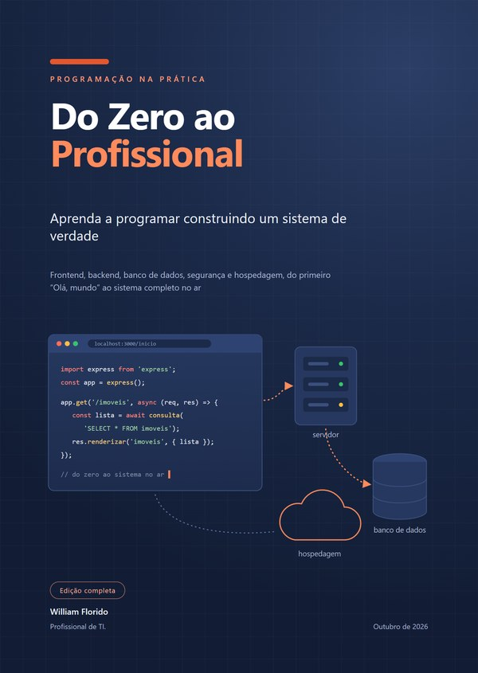

# Do Zero ao Profissional

**Aprenda a programar construindo um sistema de verdade**

Um livro para quem não sabe nada, ou quase nada, de programação e quer chegar a desenvolver um sistema completo: frontend, backend, banco de dados, segurança e hospedagem, do primeiro "Olá, mundo" ao sistema no ar.

Ao longo de 56 capítulos, você constrói o **Aurora**, o sistema interno de uma imobiliária fictícia, inspirado no SIE, um sistema real feito sob medida para uma empresa real. Cada capítulo explica um assunto, mostra o código daquela etapa (com as saídas reais, de quem rodou o código de verdade) e traz exercícios, com as respostas no fim do livro.

## Baixe o livro

Os arquivos estão na área de downloads do repositório, a **[última versão (Releases)](https://github.com/william-frdo/do-zero-ao-profissional/releases/latest)**:

- **PDF**, para ler e imprimir;
- **Word (.docx)**, editável.

## O que tem dentro

| Parte | Assunto |
|---|---|
| I | Primeiros passos |
| II | Lógica e JavaScript do zero |
| III | Ferramentas do profissional |
| IV | Frontend: as telas |
| V | Backend: o servidor |
| VI | Banco de dados |
| VII | Segurança |
| VIII | Construindo o Aurora |
| IX | Qualidade |
| X | Colocando no ar |
| XI | As ferramentas do mercado |
| XII | A carreira |

E cinco apêndices: as respostas de todos os exercícios, uma referência rápida, um glossário, o estudo de caso do SIE e as leituras recomendadas.

## O código do Aurora

O sistema que o livro constrói está publicado, completo, em **[github.com/william-frdo/aurora](https://github.com/william-frdo/aurora)**, com o histórico dos commits mostrando o sistema crescer capítulo a capítulo.

## Licença

O livro está licenciado sob a licença **[Creative Commons Atribuição-NãoComercial-CompartilhaIgual 4.0 Internacional (CC BY-NC-SA 4.0)](https://creativecommons.org/licenses/by-nc-sa/4.0/)**: você pode copiar, compartilhar e adaptar o conteúdo, desde que dê o crédito ao autor, não o use para fins comerciais e distribua as adaptações sob a mesma licença. O texto completo está no arquivo [`LICENSE`](LICENSE).

O código do Aurora tem licença própria, a MIT.

## Sobre o autor

**William Florido** é Líder de TI da Emaximóvel, técnico em Desenvolvimento de Sistemas pela Etec Rubens de Faria e Souza e bacharel em Ciência da Computação pela Universidade de Sorocaba (Uniso). Trabalha com computadores desde 2003 e, construindo o SIE, decidiu transformar a experiência num material de estudo. O livro foi escrito com a ajuda de uma inteligência artificial, o Claude, da Anthropic, sob a direção do autor e a partir do projeto dele.

[LinkedIn](https://www.linkedin.com/in/william-florido/) · [GitHub](https://github.com/william-frdo)
